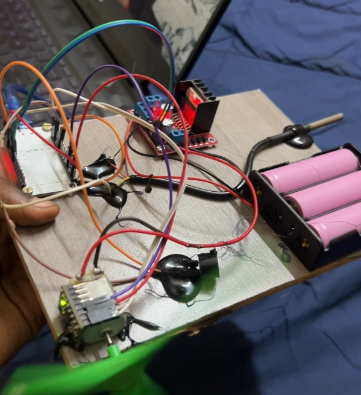

# DC Motor Fault Detection System Using ESP32

An experimental system that monitors a DC motor for excessive vibration and temperature. When it detects a fault, it stops the motor, activates a buzzer, and sends a Telegram alert.

## Overview

The ESP32 monitors motor vibration using an MPU6050 sensor and temperature using a DS18B20 sensor. The motor is controlled by an L298N motor driver and powered by a 12 V lithium-ion battery.

If an extra load, such as a bolt attached to one fan blade, makes the fan unbalanced, the MPU6050 can detect the resulting vibration. If vibration or temperature exceeds the configured limit, the ESP32 stops the motor, turns on the buzzer, and sends a Telegram message.

## Key Features

- Monitors motor vibration with an MPU6050
- Monitors motor temperature with a DS18B20
- Controls the motor through an L298N driver
- Stops the motor when vibration or temperature exceeds configured limits
- Activates a buzzer when a fault is detected
- Sends fault notifications through Telegram

## System Design

The MPU6050 and DS18B20 send readings to the ESP32. The ESP32 compares those readings with configured vibration and temperature limits. If either limit is exceeded, it stops the motor through the L298N driver, activates the buzzer, and sends a Telegram alert.

## Hardware Components

| Component | Quantity | Purpose |
|---|---:|---|
| ESP32 | 1 | Reads sensors, controls the motor, and sends Telegram alerts |
| MPU6050 | 1 | Detects motor vibration |
| DS18B20 temperature sensor | 1 | Measures motor temperature |
| DC motor | 1 | Motor being monitored |
| L298N motor driver | 1 | Controls the DC motor |
| 12 V lithium-ion battery | 1 | Powers the motor |
| Buzzer | 1 | Provides an audible fault alert |

## Software and Tools

- Programming language: Arduino C/C++
- IDE: Arduino IDE
- Notification service: Telegram

## Source Code

The Arduino IDE source code is included in this repository: [`motor_fault_detection.ino`](motor_fault_detection.ino).

## Project Image

## How It Works

1. The ESP32 reads vibration measurements from the MPU6050.
2. The ESP32 reads temperature measurements from the DS18B20.
3. If vibration exceeds the configured limit, the ESP32 stops the motor, activates the buzzer, and sends a Telegram alert.
4. If temperature exceeds the configured limit, the ESP32 stops the motor and sends a Telegram alert.
5. The sensors continue to be monitored while the motor is running.

## How to Build and Run

1. Connect the MPU6050 and DS18B20 to the ESP32.
2. Connect the DC motor and battery to the L298N motor driver according to the component specifications.
3. Connect the L298N control pins and buzzer to the ESP32.
4. Set the vibration and temperature limits in the program.
5. Configure the Wi-Fi connection and Telegram bot details.
6. Upload the program to the ESP32 using the Arduino IDE.
7. Test the system under controlled conditions, starting with a balanced fan before trying a small imbalance.

## Limitations and Future Improvements

- Vibration and temperature limits must be calibrated for the motor and sensor mounting.
- Telegram alerts require an internet connection.
- This is an experimental project, not a certified industrial protection system.
- Future improvements could include recording sensor data and displaying live readings on a dashboard.

## Team and Contributions

- Meenakshi Sundaram — designed and built the project independently.
